# CloudNine Systems: Complete Logical ERD

Based on the five-page CloudNine Systems project brief. This is a proposed logical design; the brief does not prescribe a single database schema. The model contains 42 entities and 90 relationships.

## Reading the diagram

- `PK`: primary key; `FK`: foreign key.
- `||`: exactly one; `o|`: zero or one; `o{`: zero or many; `|{`: one or many.
- Optional foreign keys and constraints that Mermaid cannot express are explained below.
- Use the [module diagrams](CloudNine_ERD_Modules.md) for a more readable view of the same model.

## Complete diagram

```mermaid
erDiagram
    direction LR
    CLIENT ||--o{ CLIENT_RELATIONSHIP : parent
    CLIENT ||--o{ CLIENT_RELATIONSHIP : child
    CLIENT ||--o{ CLIENT_MEMBERSHIP : has
    USER ||--o{ CLIENT_MEMBERSHIP : belongs
    USER ||--o| STAFF : staff_profile
    USER ||--o{ CREDENTIAL : authenticates_with
    CLIENT ||--o{ PROJECT : owns
    REGION ||--|{ AVAILABILITY_ZONE : contains
    AVAILABILITY_ZONE ||--o{ DATA_CENTER : contains
    DATA_CENTER ||--o{ RESOURCE : houses
    RESOURCE_TYPE ||--o{ RESOURCE : classifies
    RESOURCE ||--|{ RESOURCE_CONFIGURATION : configuration_history
    RESOURCE ||--|{ RESOURCE_STATE : state_history
    STAFF o|--o{ RESOURCE_STATE : records
    RESOURCE ||--o{ RESOURCE_RELATIONSHIP : source
    RESOURCE ||--o{ RESOURCE_RELATIONSHIP : target
    RESOURCE ||--o{ RESOURCE_SERVICE : supports
    SERVICE ||--o{ RESOURCE_SERVICE : available_on
    CLIENT ||--o{ CONTRACT : signs
    CLIENT ||--o{ RESERVATION : makes
    CONTRACT o|--o{ RESERVATION : governs
    RESERVATION ||--|{ RESERVATION_REVISION : revision_history
    USER ||--o{ RESERVATION_REVISION : changes
    STAFF o|--o{ RESERVATION_REVISION : approves
    RESERVATION_REVISION ||--|{ RESERVATION_ITEM : requests
    RESOURCE_TYPE ||--o{ RESERVATION_ITEM : requested_type
    REGION o|--o{ RESERVATION_ITEM : preferred_region
    AVAILABILITY_ZONE o|--o{ RESERVATION_ITEM : preferred_zone
    DATA_CENTER o|--o{ RESERVATION_ITEM : preferred_facility
    RESERVATION_ITEM ||--o{ RESERVATION_SERVICE : requests
    SERVICE ||--o{ RESERVATION_SERVICE : selected
    RESERVATION ||--o{ COMMITMENT : requires
    BILLING_ACCOUNT ||--o{ COMMITMENT : responsible
    RESERVATION ||--o{ DEPLOYMENT : supports
    PROJECT o|--o{ DEPLOYMENT : groups
    DEPLOYMENT ||--o{ WORKLOAD : runs
    DEPLOYMENT ||--o{ DEPLOYMENT_EVENT : event_history
    USER ||--o{ DEPLOYMENT_EVENT : initiates
    STAFF o|--o{ DEPLOYMENT_EVENT : authorizes
    DEPLOYMENT ||--o{ RESOURCE_ALLOCATION : allocation_history
    RESERVATION_ITEM ||--o{ RESOURCE_ALLOCATION : fulfills
    RESOURCE ||--o{ RESOURCE_ALLOCATION : assigned
    RESOURCE_CONFIGURATION o|--o{ RESOURCE_ALLOCATION : configured_as
    RESOURCE_ALLOCATION o|--o{ RESOURCE_ALLOCATION : superseded_by
    STAFF o|--o{ RESOURCE_ALLOCATION : assigns
    DEPLOYMENT ||--o{ DEPLOYMENT_SERVICE : uses
    SERVICE ||--o{ DEPLOYMENT_SERVICE : provisioned
    RESOURCE_ALLOCATION o|--o{ USAGE_RECORD : metered
    DEPLOYMENT_SERVICE o|--o{ USAGE_RECORD : metered
    RATE_PLAN ||--|{ RATE_RULE : defines
    RESOURCE_TYPE o|--o{ RATE_RULE : compute_pricing
    SERVICE o|--o{ RATE_RULE : service_pricing
    REGION o|--o{ RATE_RULE : regional_pricing
    CONTRACT ||--o{ CONTRACT_RATE_PLAN : selects
    RATE_PLAN ||--o{ CONTRACT_RATE_PLAN : contracted
    CLIENT ||--o{ BILLING_ACCOUNT : responsible_party
    USER o|--o{ BILLING_ACCOUNT : billing_contact
    CLIENT ||--o{ BILLING_RULE : sets
    PROJECT o|--o{ BILLING_RULE : project_scope
    DEPLOYMENT o|--o{ BILLING_RULE : deployment_scope
    BILLING_RULE ||--|{ BILLING_RULE_SHARE : defines
    BILLING_ACCOUNT ||--o{ BILLING_RULE_SHARE : share_recipient
    DEPLOYMENT ||--o{ CHARGE : incurs
    USAGE_RECORD o|--o{ CHARGE : basis
    RATE_RULE o|--o{ CHARGE : priced_using
    CHARGE o|--o{ CHARGE : adjusted_by
    STAFF o|--o{ CHARGE : authorizes
    CHARGE ||--|{ CHARGE_SHARE : distributed
    BILLING_ACCOUNT ||--o{ CHARGE_SHARE : pays
    BILLING_RULE o|--o{ CHARGE_SHARE : applied_rule
    BILLING_ACCOUNT ||--o{ INVOICE : receives
    INVOICE o|--o{ CHARGE_SHARE : contains
    BILLING_ACCOUNT ||--o{ PAYMENT : makes
    PAYMENT ||--o{ PAYMENT_APPLICATION : applied
    INVOICE o|--o{ PAYMENT_APPLICATION : settled
    COMMITMENT o|--o{ PAYMENT_APPLICATION : funded
    USER ||--o{ ACCESS_GRANT : receives
    STAFF o|--o{ ACCESS_GRANT : grants
    CLIENT o|--o{ ACCESS_GRANT : client_scope
    PROJECT o|--o{ ACCESS_GRANT : project_scope
    DEPLOYMENT o|--o{ ACCESS_GRANT : deployment_scope
    RESOURCE o|--o{ ACCESS_GRANT : resource_scope
    SERVICE o|--o{ ACCESS_GRANT : service_scope
    USER o|--o{ AUDIT_EVENT : actor
    CREDENTIAL o|--o{ AUDIT_EVENT : authentication
    CLIENT o|--o{ AUDIT_EVENT : context
    RESERVATION o|--o{ AUDIT_EVENT : reservation_action
    DEPLOYMENT o|--o{ AUDIT_EVENT : deployment_action
    RESOURCE o|--o{ AUDIT_EVENT : resource_action
    SERVICE o|--o{ AUDIT_EVENT : service_action
    CLIENT {
        int client_id PK
        string name
        string client_type
        string contact_email
        string reliability_rating
    }
    CLIENT_RELATIONSHIP {
        int relationship_id PK
        int parent_client_id FK
        int child_client_id FK
        string relationship_type
        datetime valid_from
        datetime valid_to
    }
    USER {
        int user_id PK
        string name
        string email
        string status
    }
    CLIENT_MEMBERSHIP {
        int membership_id PK
        int client_id FK
        int user_id FK
        string role
        datetime valid_from
        datetime valid_to
    }
    STAFF {
        int staff_id PK
        int user_id FK
        string staff_role
    }
    CREDENTIAL {
        int credential_id PK
        int user_id FK
        string credential_type
        string credential_reference
        datetime expires_at
        datetime revoked_at
    }
    PROJECT {
        int project_id PK
        int client_id FK
        string name
    }
    REGION {
        int region_id PK
        string name
        string regulatory_environment
    }
    AVAILABILITY_ZONE {
        int zone_id PK
        int region_id FK
        string name
        string redundancy
        string connectivity
    }
    DATA_CENTER {
        int data_center_id PK
        int zone_id FK
        string name
        string location
    }
    RESOURCE_TYPE {
        int resource_type_id PK
        string name
        string intended_workload
        string capacity_spec
    }
    RESOURCE {
        int resource_id PK
        int resource_type_id FK
        int data_center_id FK
        string local_identifier
        string identifier_scope
    }
    RESOURCE_CONFIGURATION {
        int configuration_id PK
        int resource_id FK
        string performance_tier
        string capacity_spec
        datetime valid_from
        datetime valid_to
    }
    RESOURCE_RELATIONSHIP {
        int relationship_id PK
        int source_resource_id FK
        int target_resource_id FK
        string relationship_type
        datetime valid_from
        datetime valid_to
    }
    RESOURCE_STATE {
        int state_id PK
        int resource_id FK
        string status
        string reason
        datetime starts_at
        datetime ends_at
        int recorded_by_staff_id FK
    }
    SERVICE {
        int service_id PK
        string name
        string service_type
        string unit
    }
    RESOURCE_SERVICE {
        int resource_service_id PK
        int resource_id FK
        int service_id FK
        datetime valid_from
        datetime valid_to
    }
    CONTRACT {
        int contract_id PK
        int client_id FK
        datetime starts_at
        datetime ends_at
        string sla_terms
        string priority_terms
        string discount_terms
    }
    RESERVATION {
        int reservation_id PK
        int client_id FK
        int contract_id FK
        datetime created_at
        string status
    }
    RESERVATION_REVISION {
        int revision_id PK
        int reservation_id FK
        int revision_number
        datetime start_time
        datetime end_time
        string change_reason
        datetime created_at
        int changed_by_user_id FK
        int approved_by_staff_id FK
    }
    RESERVATION_ITEM {
        int reservation_item_id PK
        int revision_id FK
        int resource_type_id FK
        int preferred_region_id FK
        int preferred_zone_id FK
        int preferred_data_center_id FK
        decimal quantity
        string capacity_requirement
        string location_constraint
    }
    RESERVATION_SERVICE {
        int reservation_service_id PK
        int reservation_item_id FK
        int service_id FK
        string options
    }
    COMMITMENT {
        int commitment_id PK
        int reservation_id FK
        int billing_account_id FK
        string commitment_type
        decimal required_amount
        string status
        string terms
    }
    DEPLOYMENT {
        int deployment_id PK
        int reservation_id FK
        int project_id FK
        string name
        datetime started_at
        datetime ended_at
        string confidentiality_level
    }
    DEPLOYMENT_EVENT {
        int event_id PK
        int deployment_id FK
        string event_type
        int priority_after
        string scaling_mode_after
        datetime event_time
        string reason
        int actor_user_id FK
        int authorized_by_staff_id FK
    }
    WORKLOAD {
        int workload_id PK
        int deployment_id FK
        string name
        string workload_type
    }
    RESOURCE_ALLOCATION {
        int allocation_id PK
        int deployment_id FK
        int reservation_item_id FK
        int resource_id FK
        int configuration_id FK
        datetime starts_at
        datetime ends_at
        string allocated_capacity
        string allocation_status
        int supersedes_allocation_id FK
        string change_reason
        int assigned_by_staff_id FK
    }
    DEPLOYMENT_SERVICE {
        int deployment_service_id PK
        int deployment_id FK
        int service_id FK
        datetime starts_at
        datetime ends_at
        string options
    }
    USAGE_RECORD {
        int usage_id PK
        int allocation_id FK
        int deployment_service_id FK
        string metric_type
        decimal quantity
        string unit
        datetime period_start
        datetime period_end
        string record_type
        datetime recorded_at
    }
    RATE_PLAN {
        int rate_plan_id PK
        string name
        string currency
    }
    RATE_RULE {
        int rate_rule_id PK
        int rate_plan_id FK
        int resource_type_id FK
        int service_id FK
        int region_id FK
        string performance_tier
        datetime valid_from
        datetime valid_to
        string time_window
        string duration_min
        string duration_max
        string usage_min
        string usage_max
        string unit
        decimal unit_price
        string discount_rule
    }
    CONTRACT_RATE_PLAN {
        int contract_rate_plan_id PK
        int contract_id FK
        int rate_plan_id FK
        datetime valid_from
        datetime valid_to
    }
    BILLING_ACCOUNT {
        int billing_account_id PK
        int responsible_client_id FK
        string name
        int billing_contact_user_id FK
        string currency
    }
    BILLING_RULE {
        int billing_rule_id PK
        int client_id FK
        int project_id FK
        int deployment_id FK
        datetime valid_from
        datetime valid_to
        string rule_description
    }
    BILLING_RULE_SHARE {
        int share_id PK
        int billing_rule_id FK
        int billing_account_id FK
        decimal share_percentage
    }
    CHARGE {
        int charge_id PK
        int deployment_id FK
        int usage_id FK
        int rate_rule_id FK
        int adjustment_of_charge_id FK
        int authorized_by_staff_id FK
        string charge_type
        decimal amount
        string currency
        string status
        string reason
        datetime created_at
    }
    CHARGE_SHARE {
        int charge_share_id PK
        int charge_id FK
        int billing_account_id FK
        int billing_rule_id FK
        int invoice_id FK
        decimal allocated_amount
    }
    INVOICE {
        int invoice_id PK
        int billing_account_id FK
        datetime issued_at
        datetime due_at
        string status
    }
    PAYMENT {
        int payment_id PK
        int billing_account_id FK
        decimal amount
        string currency
        string payment_type
        datetime paid_at
        string status
        string external_reference
    }
    PAYMENT_APPLICATION {
        int application_id PK
        int payment_id FK
        int invoice_id FK
        int commitment_id FK
        decimal applied_amount
    }
    ACCESS_GRANT {
        int grant_id PK
        int user_id FK
        int client_id FK
        int project_id FK
        int deployment_id FK
        int resource_id FK
        int service_id FK
        string permission
        datetime valid_from
        datetime valid_to
        int granted_by_staff_id FK
    }
    AUDIT_EVENT {
        int audit_event_id PK
        int actor_user_id FK
        int credential_id FK
        int client_id FK
        int reservation_id FK
        int deployment_id FK
        int resource_id FK
        int service_id FK
        datetime occurred_at
        string action
        string result
        string details
    }
```

## Requirements coverage

| Module | Entities | Requirements from the brief |
|---|---|---|
| Clients and people | CLIENT, CLIENT_RELATIONSHIP, USER, CLIENT_MEMBERSHIP, STAFF, CREDENTIAL, PROJECT | Individuals, teams, organizations, contacts, separate users and payers, authentication |
| Infrastructure | REGION, AVAILABILITY_ZONE, DATA_CENTER, RESOURCE_TYPE, RESOURCE, RESOURCE_CONFIGURATION, RESOURCE_RELATIONSHIP, RESOURCE_STATE, SERVICE, RESOURCE_SERVICE | Geography, capacity, performance, configuration history, components, dependencies, maintenance, failures, shared services |
| Reservations and commitments | CONTRACT, RESERVATION, RESERVATION_REVISION, RESERVATION_ITEM, RESERVATION_SERVICE, COMMITMENT | Service commitments, advance reservations, revisions, multiple resource types, service options, deposits |
| Deployments and usage | DEPLOYMENT, DEPLOYMENT_EVENT, WORKLOAD, RESOURCE_ALLOCATION, DEPLOYMENT_SERVICE, USAGE_RECORD | Multiple workloads and resources, multiple zones, scaling, pause/resume, migration, priorities, estimated and actual consumption |
| Pricing and billing | RATE_PLAN, RATE_RULE, CONTRACT_RATE_PLAN, BILLING_ACCOUNT, BILLING_RULE, BILLING_RULE_SHARE, CHARGE, CHARGE_SHARE, INVOICE, PAYMENT, PAYMENT_APPLICATION | Time/duration/volume rates, discounts, cost sharing, estimates and final charges, surcharges, credits, payments, refunds |
| Access and audit | ACCESS_GRANT, AUDIT_EVENT | Confidentiality, scoped access, authentication and access logs, staff actions, change records |

## Business rules and modeling assumptions

1. **Clients and users.** CLIENT represents an individual, team, or organization. USER represents a person who can authenticate. CLIENT_RELATIONSHIP records organizational and departmental relationships; CLIENT_MEMBERSHIP records membership and roles. BILLING_ACCOUNT.responsible_client_id identifies the payer, which may differ from the client using a deployment.
2. **Geographic hierarchy (assumption).** Each data center belongs to one availability zone, and each zone belongs to one region. RESOURCE represents an independently managed physical or logical resource. A cluster spanning zones uses a logical parent and children in different locations. The parent's data center is its administrative home, not the location of every component.
3. **Composition and dependencies.** RESOURCE_RELATIONSHIP.relationship_type distinguishes component_of, depends_on, shared_storage, and shared_network. Relationships have validity intervals. Prohibit self-dependencies and composition cycles. Parents and components can be allocated separately, but shared capacity must not be allocated or billed twice.
4. **Resource history.** RESOURCE_CONFIGURATION and RESOURCE_STATE retain history. Capacity specifications include processing, memory, storage, and networking characteristics. If required by the course's normalization standard, split capacity_spec into a RESOURCE_CAPACITY table with configuration, metric, value, and unit. Effective configuration and operational-state intervals must not conflict. Reservation and occupancy are derived from allocations; operational states include operational, maintenance, repair, and failure.
5. **Reservation revisions.** Each change creates a RESERVATION_REVISION instead of overwriting history. Each revision has at least one RESERVATION_ITEM. The requested resource type is required; geographic preferences are optional. If region, zone, and data center are supplied together, they must agree. location_constraint distinguishes mandatory constraints from preferences that permit substitution. Start time must precede end time.
6. **Deployment ownership (assumption).** Each deployment belongs to one reservation, and one reservation can support multiple deployments. Project and contract associations are optional. A newly created deployment may not yet have workloads or actual resource allocations.
7. **Planned and actual allocations.** RESOURCE_ALLOCATION supports planned, active, released, and cancelled assignments. Capacity and time intervals support forecasts and prevent over-allocation. configuration_id may be null for a planned allocation but is required for an active allocation; the configuration must belong to the allocated resource. The reservation item must belong to the deployment's reservation. The optional configuration relationship is shown explicitly in the diagram.
8. **Migration and scaling.** End the old allocation and create a replacement, linking supersedes_allocation_id to the old assignment. One old allocation can have several replacements. Record reasons, staff actions, and related billing adjustments. DEPLOYMENT_EVENT records scaling, pause/resume, priority, and automatic/manual mode changes. Current deployment state is derived from these events.
9. **Usage source.** Exactly one of USAGE_RECORD.allocation_id and deployment_service_id must be populated (XOR). record_type distinguishes estimated and actual consumption. Quantity has a unit and measurement interval. Estimated and actual records for the same consumption must not both contribute to final charges.
10. **Rates and discounts.** Exactly one of RATE_RULE.resource_type_id and service_id must be populated (XOR). Optional region, performance tier, time window, duration, and volume thresholds restrict applicability. Preserve validity dates. RATE_PLAN defines rates; CONTRACT_RATE_PLAN associates contracts with plans; discount_rule expresses long-term or bundled discounts. Define deterministic matching precedence to avoid ambiguous rates. Normalize complex discount conditions and actions further when implementation requirements are known.
11. **Charges and adjustments.** CHARGE.status is provisional, final, or void; charge_type includes usage, surcharge, and credit. Ordinary usage charges require usage_id and rate_rule_id; manual adjustments may omit them. Credits use negative amounts. adjustment_of_charge_id can reference the original charge. Manual adjustments require a staff authorizer and a reason. Each charge belongs to one deployment; this design also assigns emergency support and other ancillary fees to a deployment. This is a modeling assumption.
12. **Cost-sharing rules.** BILLING_RULE can apply at client, project, or deployment scope. project_id and deployment_id cannot both be populated; both null means client scope. Precedence is deployment > project > client. Effective rules at the same scope must not overlap. BILLING_RULE_SHARE percentages must total 100%.
13. **Charge shares and invoices.** Every charge has at least one CHARGE_SHARE, even when a single account pays. Shares must total the charge amount and use consistent currency. billing_rule_id is optional for directly assigned payers. Shares are historical snapshots: later rule changes must not alter them. Only final charges may be invoiced. invoice_id is null until invoicing. Invoice and share billing accounts must agree.
14. **Deposits and payments.** COMMITMENT distinguishes deposit from advance_commitment. Deposits can be funded by payments; other commitments may contain only terms. PAYMENT.payment_type includes payment and refund. A credit adjustment and an actual cash refund are separate records. Exactly one of PAYMENT_APPLICATION.invoice_id and commitment_id must be populated (XOR). A payment can fund multiple invoices or deposits, but applications must not exceed its available amount. Moving a deposit to invoice settlement must transfer its application to prevent double use.
15. **Access controls.** Exactly one of ACCESS_GRANT.client_id, project_id, deployment_id, resource_id, and service_id must be populated (XOR). permission and validity intervals define allowed actions. CREDENTIAL stores password hashes or references to secure credential storage, never plaintext passwords or private keys.
16. **Audit records.** AUDIT_EVENT may refer to several related objects, or none for a general authentication event. Automated events may omit actor_user_id. Human actions require an actor; STAFF is identified through USER. Failed authentication may omit credential_id. Maintenance and availability changes also produce audit records.
17. **Uniqueness and integrity.** RESOURCE(local_identifier, identifier_scope) is unique. RESERVATION_REVISION(reservation_id, revision_number) is unique. Add appropriate composite uniqueness constraints to associative tables, and interval checks to historical records. Cross-table references must be consistent with the associated client, reservation, deployment, and resource.
18. **Derived views and policies.** Capacity forecasts, availability queries, consolidated billing, and graphical resource topology are derived from this model. Allocation policies, client qualification decisions, and fairness are business logic. POLICY and POLICY_VERSION may be added if editable policy history is required.

## Design boundaries

This ERD covers the brief's principal information requirements and historical relationships. The brief does not define exact formats for capacity metrics, SLA terms, discount conditions, or service options. Consequently, capacity_spec, sla_terms, discount_rule, and options remain logical attributes. A fully normalized implementation should split these into structured entities once their actual dimensions and rules are established.

The complete diagram is a relationship overview. The four module diagrams use the same entity names, keys, and fields. Business rules supplement constraints that Mermaid cannot show, including XOR associations, effective intervals, and monetary totals. Field types are illustrative; a physical schema still needs nullability, precision, indexes, and enforceable checks.
