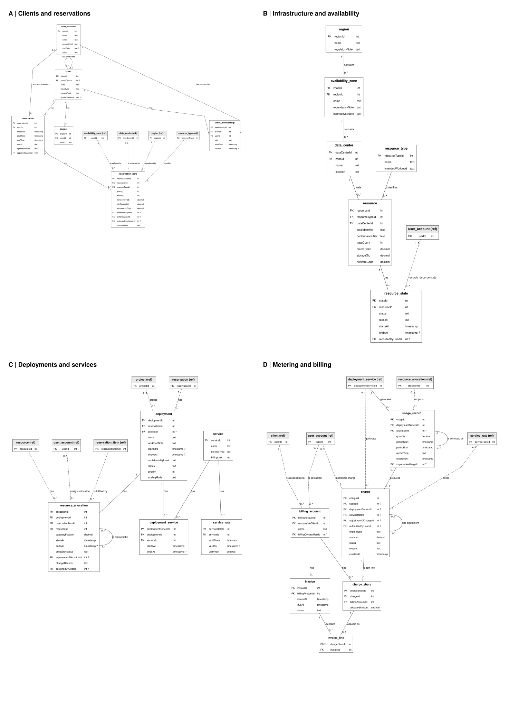
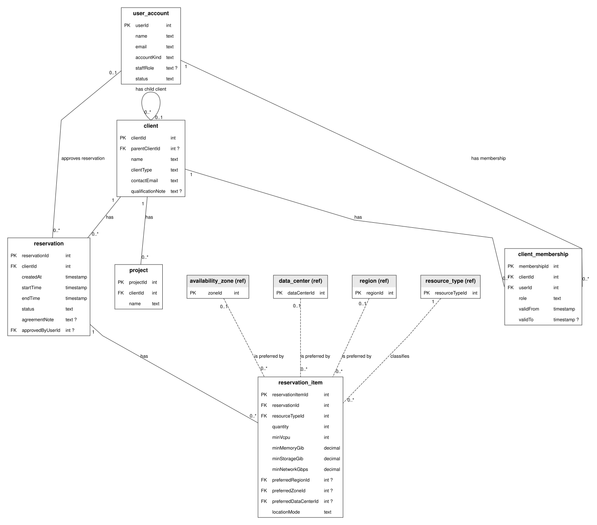
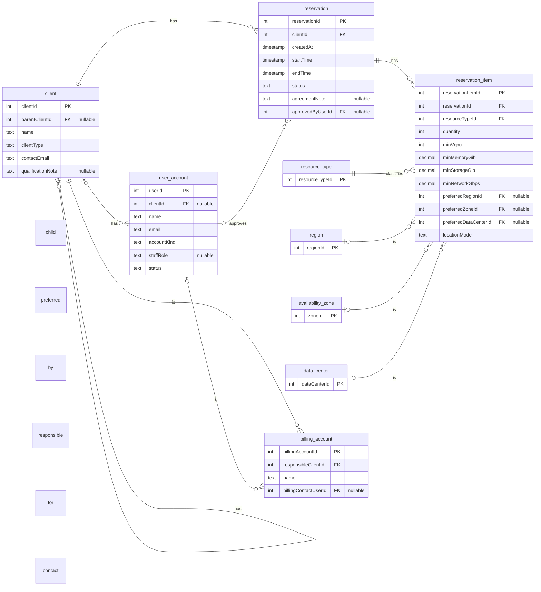
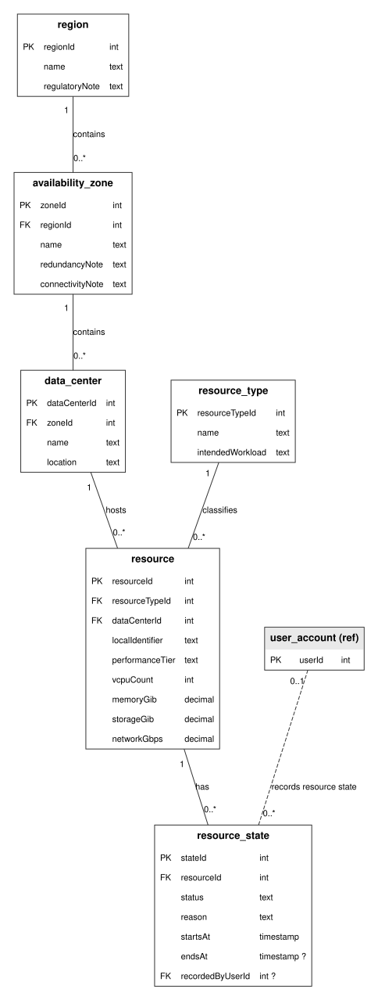
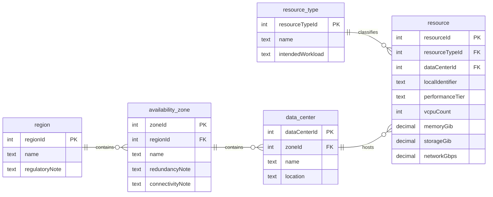
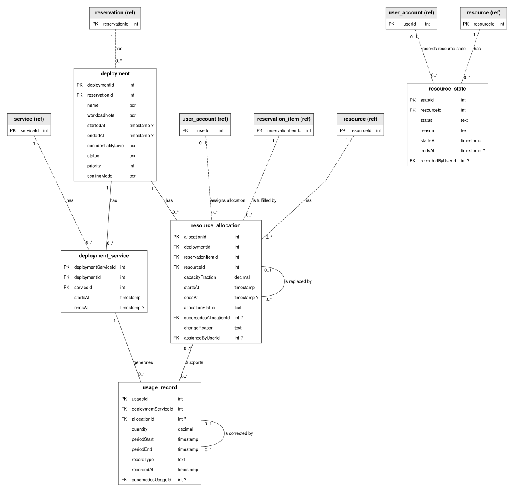
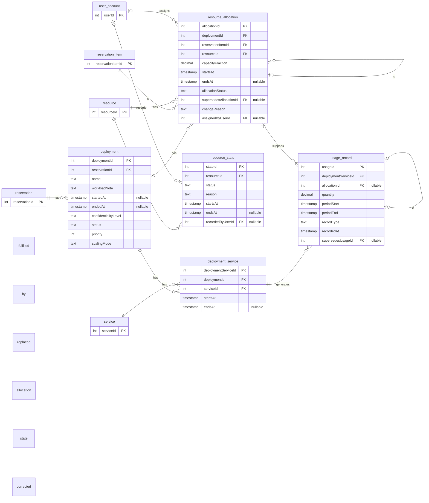
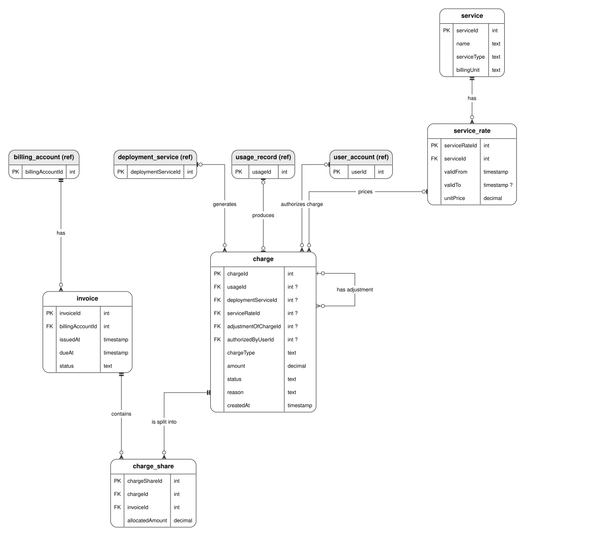
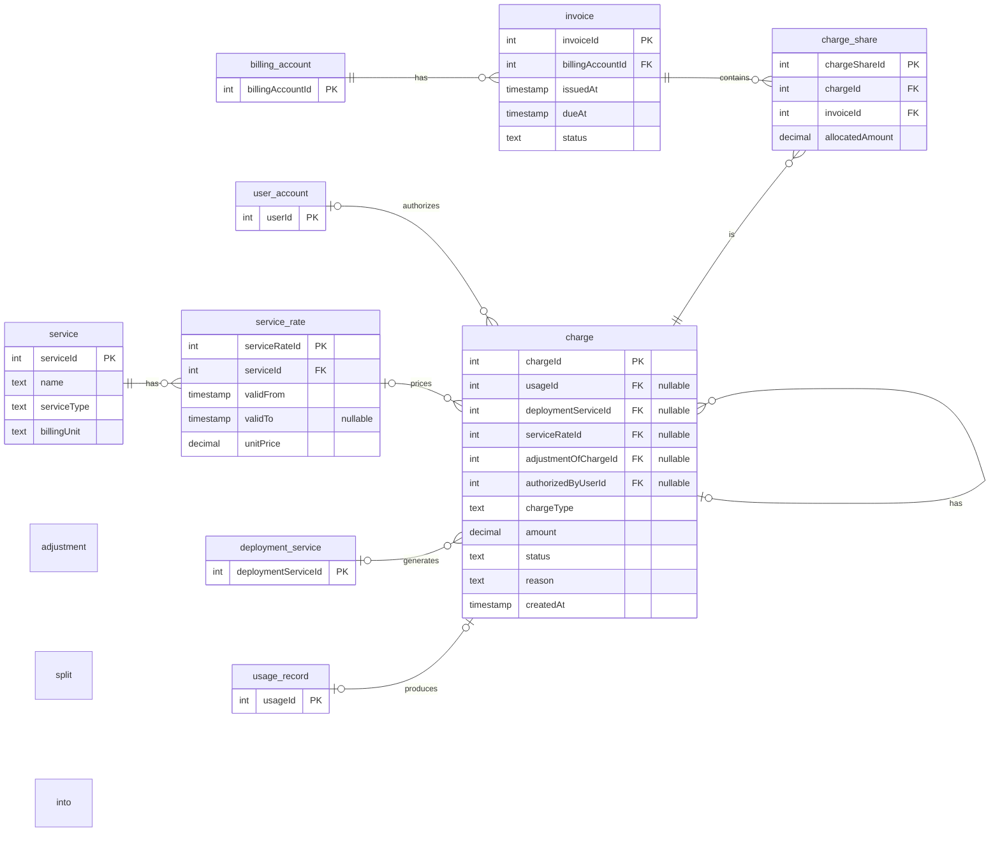

# Group 4 - ERD ownership views
20 tables; five tables per owner. Names will be mapped to A-D later.

[Submission PDF](../../output/pdf/Group4_ERD.pdf) | [Analysis and constraints](Group4_Analysis_Draft.md)

## Member A: Clients and reservations
5 owned tables. Shaded boxes show primary keys of entities owned by another member.

Editable Mermaid source

## Member B: Infrastructure
5 owned tables. Shaded boxes show primary keys of entities owned by another member.

Editable Mermaid source

## Member C: Deployments and usage
5 owned tables. Shaded boxes show primary keys of entities owned by another member.

Editable Mermaid source

## Member D: Services and billing
5 owned tables. Shaded boxes show primary keys of entities owned by another member.

Editable Mermaid source

